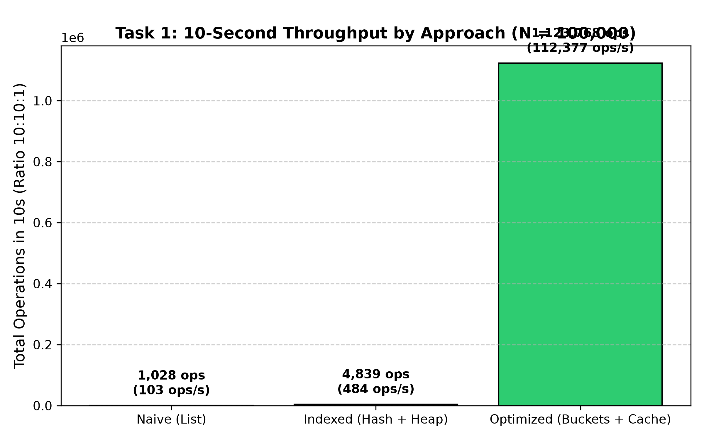
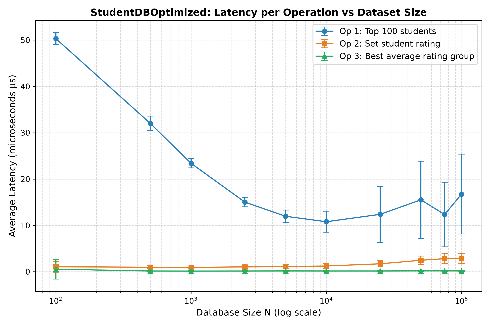
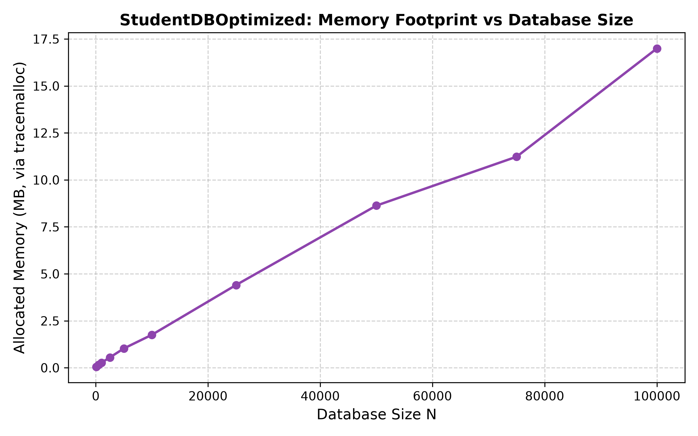
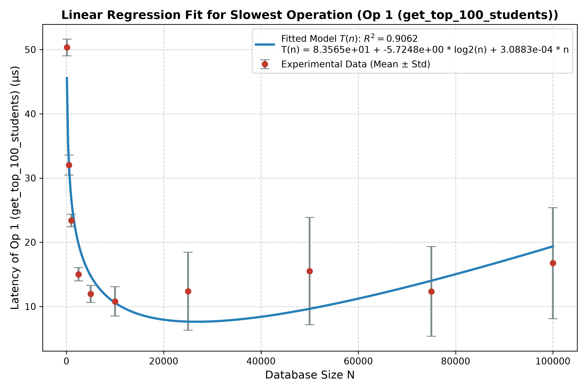
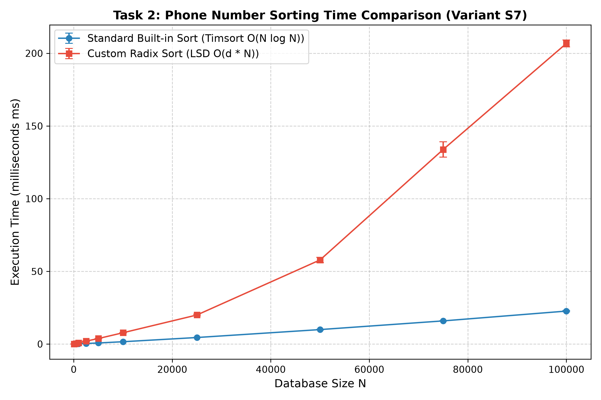

# Звіт до Домашнього завдання №1: Сортування і структури даних

Олександр Оксентюк  
**Варіанти:**  
- **Задача I:** Варіант **V5** (Співвідношення операцій $A:B:C = 10 : 10 : 1$)
  1. Повернути 100 студентів з найвищим рейтингом.
  2. Встановити рейтинг студенту за його електронною поштою (`m_email`).
  3. Знайти групу або групи з найбільшим середнім рейтингом студентів.
- **Задача II:** Варіант **S7** (Посортувати всіх студентів за `m_phone_number` і зберегти в CSV-файл).

---

## 1. Задача I: Порівняння 3 підходів (Тест на пропускну здатність за 10 секунд)

Було реалізовано 3 архітектурні підходи:
1. **StudentDBNaive:** Лінійне сховище (список `list[Student]`). Операція 1 виконує повне сортування $O(N \log N)$, операція 2 — лінійний пошук $O(N)$, операція 3 — повний перерахунок середніх значень $O(N)$.
2. **StudentDBIndexed:** Хеш-таблиця `email -> Student` для пошуку за $O(1)$, хеш-таблиця сум і кількостей за групами $O(1)$ для інкрементального оновлення, та `heapq.nlargest` $O(N \log K)$ для топ-100.
3. **StudentDBOptimized:** Комбінована індексація — бакетна структура для рейтингу (O(1) переміщення, O(K log K) збір топ-100), хеш-таблиця для миттєвого пошуку студента та кешування групи-лідера з ледачою інвалідацією.

### Результати 10-секундного експерименту ($N = 100\,000$, співвідношення 10:10:1):

| Підхід | Всього операцій за 10с | Пропускна здатність (оп/сек) | Op 1 виконано | Op 2 виконано | Op 3 виконано |
|---|---|---|---|---|---|
| **Naive (List)** | 1,028 | 102.7 | 490 | 490 | 48 |
| **Indexed (Hash + Heap)** | 4,839 | 483.9 | 2,304 | 2,304 | 231 |
| **Optimized (Buckets + Cache)** | 1,123,768 | 112,376.6 | 535,128 | 535,129 | 53,511 |

---

## 2. Масштабування найкращого підходу (StudentDBOptimized)

Для найкращого варіанту проведено експеримент на 10 різних розмірах початкової бази даних ($N \in [100, 100\,000]$), по 5 незалежних прогонів на кожну точку. Пам'ять виміряно за допомогою модуля `tracemalloc`.

### Таблиця результатів масштабування:

| Розмір $N$ | Пам'ять (МБ) | Op 1 Latency (мкс) | Op 2 Latency (мкс) | Op 3 Latency (мкс) |
|---|---|---|---|---|
| 100 | 0.06 | 50.32 ± 1.29 | 1.06 ± 1.16 | 0.54 ± 2.14 |
| 500 | 0.16 | 32.01 ± 1.56 | 0.97 ± 0.34 | 0.15 ± 0.07 |
| 1,000 | 0.27 | 23.40 ± 0.99 | 0.95 ± 0.27 | 0.14 ± 0.06 |
| 2,500 | 0.55 | 15.02 ± 1.03 | 1.04 ± 0.34 | 0.15 ± 0.07 |
| 5,000 | 1.03 | 11.97 ± 1.32 | 1.10 ± 0.46 | 0.16 ± 0.10 |
| 10,000 | 1.76 | 10.79 ± 2.27 | 1.23 ± 0.53 | 0.15 ± 0.09 |
| 25,000 | 4.41 | 12.38 ± 6.06 | 1.71 ± 0.67 | 0.15 ± 0.09 |
| 50,000 | 8.63 | 15.51 ± 8.34 | 2.47 ± 0.92 | 0.18 ± 0.09 |
| 75,000 | 11.23 | 12.35 ± 6.98 | 2.81 ± 1.08 | 0.18 ± 0.11 |
| 100,000 | 16.99 | 16.76 ± 8.64 | 2.83 ± 1.08 | 0.17 ± 0.10 |

---

## 3. Лінійна регресія для найповільнішої операції

Найповільнішою операцією визначено: **Op 1 (get_top_100_students)**.

Апроксимація теоретичної складності моделлю:
$$T(n) = c_1 \cdot f_1(n) + c_2 \cdot f_2(n) + c_3 \cdot f_3(n)$$
де $f_1(n) = 1$ (базовий константний оверхед виклику), $f_2(n) = \log_2(n)$ (логарифмічний пошук), $f_3(n) = n$ (лінійна компонента).

**Отримана емпірична функція:**

$$T(n) = 8.3565e+01 + -5.7248e+00 \cdot \log_2(n) + 3.0883e-04 \cdot n$$

- **Коефіцієнт детермінації ($R^2$):** `0.9062`

---

## 4. Задача II: Порівняння алгоритмів сортування (Варіант S7)

Сортування бази за полем `m_phone_number` (`38(0xx)xx-xx-xxx`):

1. **Standard Built-in Sort (Timsort):** Реалізований на мові C в інтерпретаторі Python ($O(N \log N)$).
2. **Custom LSD Radix Sort:** Власна реалізація порозрядного сортування за 9 змінними цифрами номеру телефону. Складність $O(d \cdot N) = O(N)$, де $d = 9$.

### Таблиця часу сортування (мілісекунди):

| Розмір $N$ | Built-in Timsort (мс) | Custom Radix Sort (мс) | Співвідношення (Radix / Builtin) |
|---|---|---|---|
| 100 | 0.010 ± 0.005 | 0.087 ± 0.007 | 8.7x |
| 500 | 0.051 ± 0.006 | 0.368 ± 0.007 | 7.2x |
| 1,000 | 0.132 ± 0.020 | 0.810 ± 0.068 | 6.1x |
| 2,500 | 0.365 ± 0.061 | 2.000 ± 0.233 | 5.5x |
| 5,000 | 0.730 ± 0.012 | 3.782 ± 0.044 | 5.2x |
| 10,000 | 1.586 ± 0.012 | 7.764 ± 0.076 | 4.9x |
| 25,000 | 4.483 ± 0.072 | 19.974 ± 0.540 | 4.5x |
| 50,000 | 9.943 ± 0.225 | 57.842 ± 1.835 | 5.8x |
| 75,000 | 15.916 ± 0.139 | 133.840 ± 5.248 | 8.4x |
| 100,000 | 22.665 ± 0.472 | 206.760 ± 2.320 | 9.1x |

